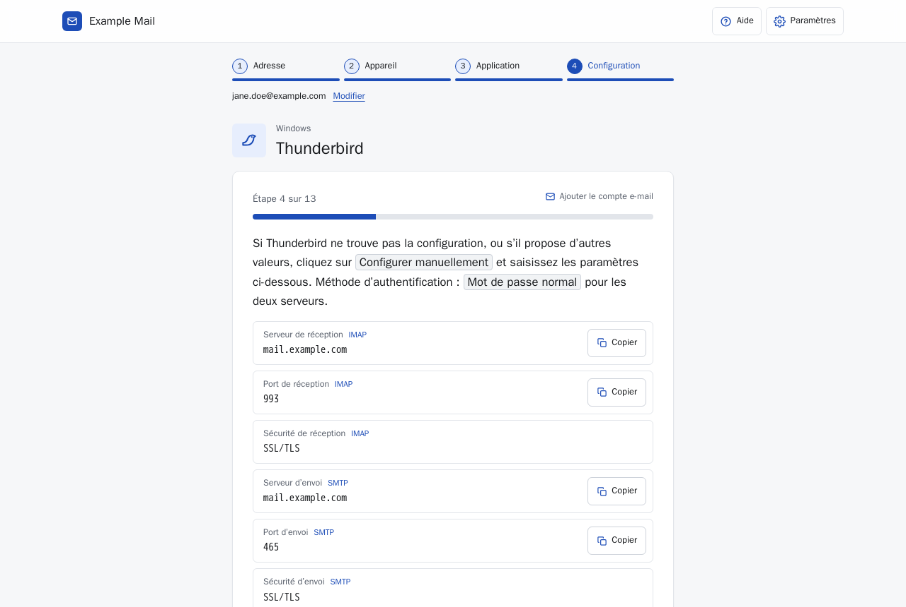
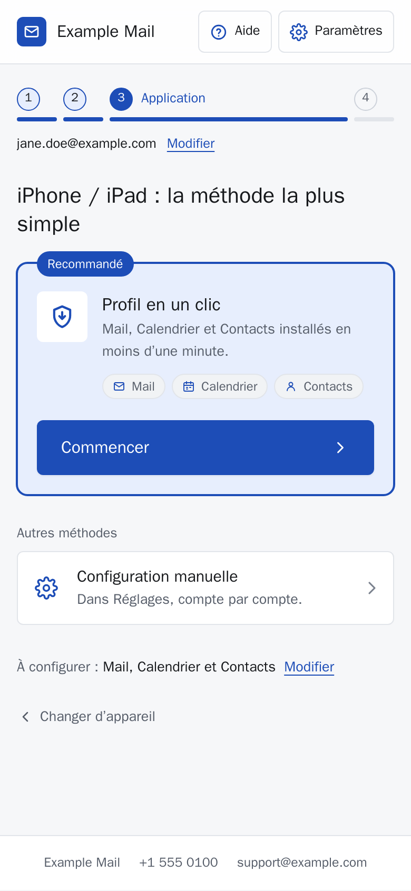

# Mail Setup

A white-label, self-hosted assistant that guides your users through setting up mail, calendar and contacts on Windows, macOS, iPhone/iPad and Android, one step at a time.

  

<p>
  
  
</p>

## Features

- Guided wizard: address, device, app, then a step-by-step guide with copyable values.
- Guides for Outlook (new and classic), CalDAV Synchronizer, Thunderbird, Apple Mail, Gmail, Samsung apps and DAVx5.
- One-tap Apple configuration profile (`.mobileconfig`) and Thunderbird autoconfig.
- QR code on desktop to continue on a phone; internal `/support` page to generate links and QR codes.
- White-label: name, logo, accent colour and support contact from environment variables.
- Light theme by default with automatic dark mode, system font, mobile friendly.
- No password asked or stored, no cookies, no tracking, strict CSP.
- Node 22, zero dependencies, native `http`; vanilla HTML/CSS/JS. Hardened Docker image.

The UI language is French. To translate it, edit `public/js/guides.js` and `public/index.html`.

## Quick start

```bash
cp .env.example .env      # edit MAIL_HOST, PUBLIC_URL, BRAND_NAME...
docker compose up -d --build
```

Open `http://localhost:8080`. Put it behind an HTTPS reverse proxy for production (see [docs/deployment.md](docs/deployment.md)).

## Configuration

Everything is configured through environment variables; all are optional.

| Variable | Default | Description |
|---|---|---|
| `HOST_PORT` | `8080` | Published host port (compose only) |
| `IMAGE_NAME` | `mail-setup` | Docker image name (compose only) |
| `CONTAINER_NAME` | `mail-setup` | Container name (compose only) |
| `PORT` | `8080` | Listening port of the Node process |
| `BRAND_NAME` | `Mail Setup` | Name shown in the UI |
| `BRAND_LOGO_URL` | empty | `/img/...` path or absolute https URL; empty = text name + neutral icon |
| `BRAND_ACCENT` | `#2563eb` | Accent colour, `#rgb` or `#rrggbb` |
| `MAIL_HOST` | `mail.example.com` | Default for IMAP, SMTP, webmail and DAV hosts |
| `IMAP_HOST` / `IMAP_PORT` / `IMAP_SECURITY` | `MAIL_HOST` / `993` / `SSL/TLS` | Incoming server |
| `SMTP_HOST` / `SMTP_PORT` / `SMTP_SECURITY` | `MAIL_HOST` / `465` / `SSL/TLS` | Outgoing server |
| `WEBMAIL_URL` | `https://MAIL_HOST/` | Webmail link |
| `DAV_PRESET` | `mdaemon` | `mdaemon` or `generic` |
| `DAV_BASE_URL` | `https://MAIL_HOST` | Base of all DAV URLs |
| `CALDAV_URL`, `CARDDAV_URL`, `TASKS_URL` | per preset | Generic server URLs shown before an address is typed |
| `DAV_DISCOVERY_URL`, `DAV_CARD_DISCOVERY_URL` | `DAV_BASE_URL/.well-known/caldav` and `/carddav` | Discovery URLs (DAVx5, CalDAV Synchronizer) |
| `DAV_PRINCIPAL_URL_TEMPLATE`, `DAV_CALENDAR_URL_TEMPLATE`, `DAV_TASKS_URL_TEMPLATE`, `DAV_CONTACTS_URL_TEMPLATE` | per preset | Personal URL templates (`{email}`, `{local}`, `{domain}`) |
| `PUBLIC_URL` | `https://config.example.com` | Public address of this app (links, QR codes) |
| `SUPPORT_PHONE`, `SUPPORT_EMAIL`, `SUPPORT_HOURS`, `SUPPORT_ADDRESS` | empty | Support contact; each hidden when empty |
| `SUPPORT_USER` | `support` | Basic auth user for `/support` |
| `SUPPORT_PASSWORD` | empty | Basic auth password; empty = `/support` returns 404 |
| `PROFILE_ORGANIZATION` | `BRAND_NAME` | Organization in the Apple profile |
| `PROFILE_ID_PREFIX` | `com.example.mailsetup` | Profile identifier prefix |
| `CALDAVSYNC_URL`, `DAVX5_GITHUB_URL`, `DAVX5_FDROID_URL`, `DAVX5_PLAY_URL`, `THUNDERBIRD_URL` | official download pages | Download links used in guides |

Details and examples: [docs/configuration.md](docs/configuration.md).

## MDaemon preset

`DAV_PRESET=mdaemon` (default) generates the MDaemon WebDAV paths, discovers shared "[Public]" calendars, tasks and contacts, and shows MDaemon-specific tips and FAQ. Use `DAV_PRESET=generic` for any standards-compliant server. See [docs/mdaemon.md](docs/mdaemon.md).

## Endpoints

| Path | Purpose |
|---|---|
| `/` | Wizard. Query params: `email`, `name`, `device` (`windows`, `macos`, `ios`, `android`), `app` (guide id, e.g. `ios-profile`, `outlook-classic`, `caldavsync`, `davx5`) |
| `/support` | Internal page (Basic auth): link and QR generator, PNG/SVG export, pre-written email/SMS |
| `/profile.mobileconfig?email=&name=&services=mail,calendar,contacts` | Unsigned Apple profile, no password; 400 on invalid email |
| `/mail/config-v1.1.xml?emailaddress=` | Thunderbird autoconfig (also at `/.well-known/autoconfig/mail/`) |
| `/api/config` | Public settings |
| `/brand.css` | Generated accent colour |
| `/healthz` | Health check |

## Security

No password is requested or stored, no cookies, strict CSP, HSTS, nosniff, QR codes generated locally. The Apple profile is unsigned and should be signed in production. See [docs/security.md](docs/security.md).

## Customising guides and screenshots

Guides live in `public/js/guides.js`, copyable values in `public/js/app.js`, styles in `public/css/app.css`. To add a screenshot, put the file in `public/img/guides/`, add `shot: 'folder/file.png'` to a step and rebuild. See [docs/customization.md](docs/customization.md).

## Project structure

```
server/            Node HTTP server, config, Apple profile, autoconfig
public/
  index.html       Wizard
  404.html
  css/             app.css
  js/              app.js, guides.js, qr.js
  img/             favicon.svg, guides/
  support/         Internal support page
docs/              Documentation
Dockerfile
docker-compose.yml
.env.example
```

## Documentation

- [Configuration](docs/configuration.md)
- [Deployment](docs/deployment.md)
- [Customization](docs/customization.md)
- [MDaemon](docs/mdaemon.md)
- [Security](docs/security.md)

## License

MIT (see LICENSE).
